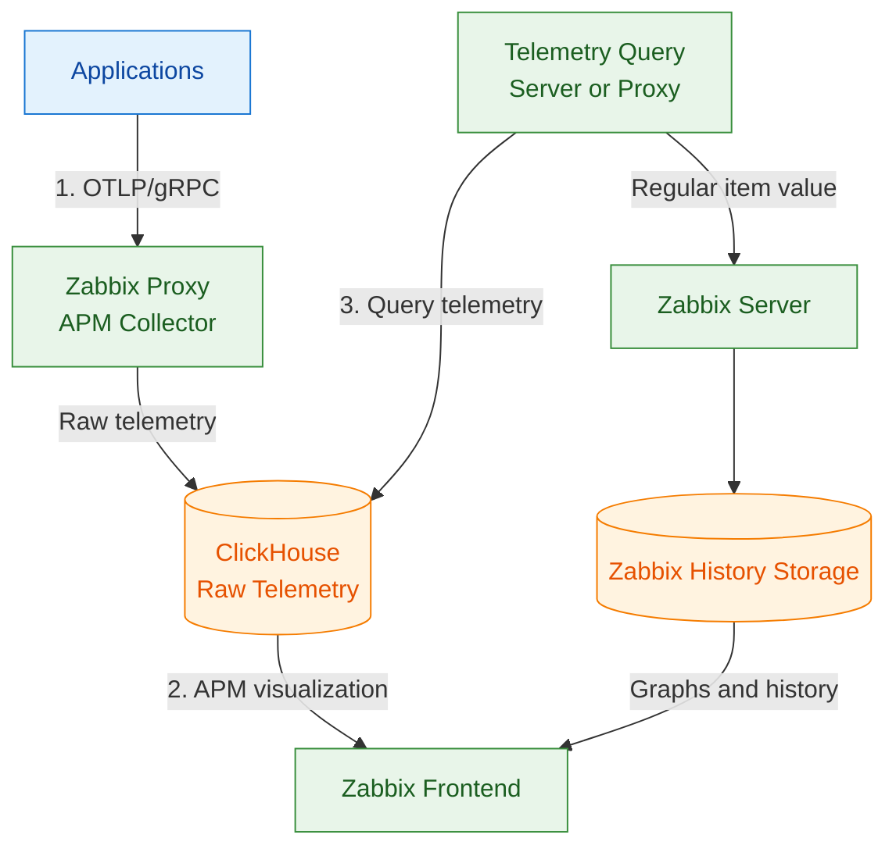
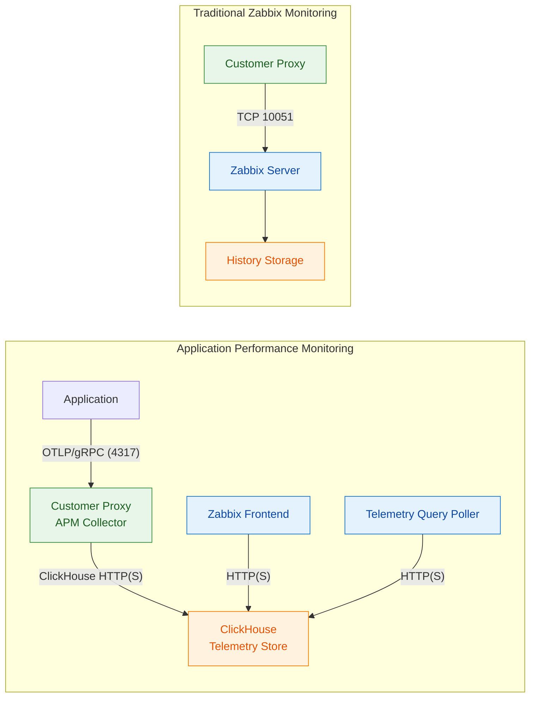
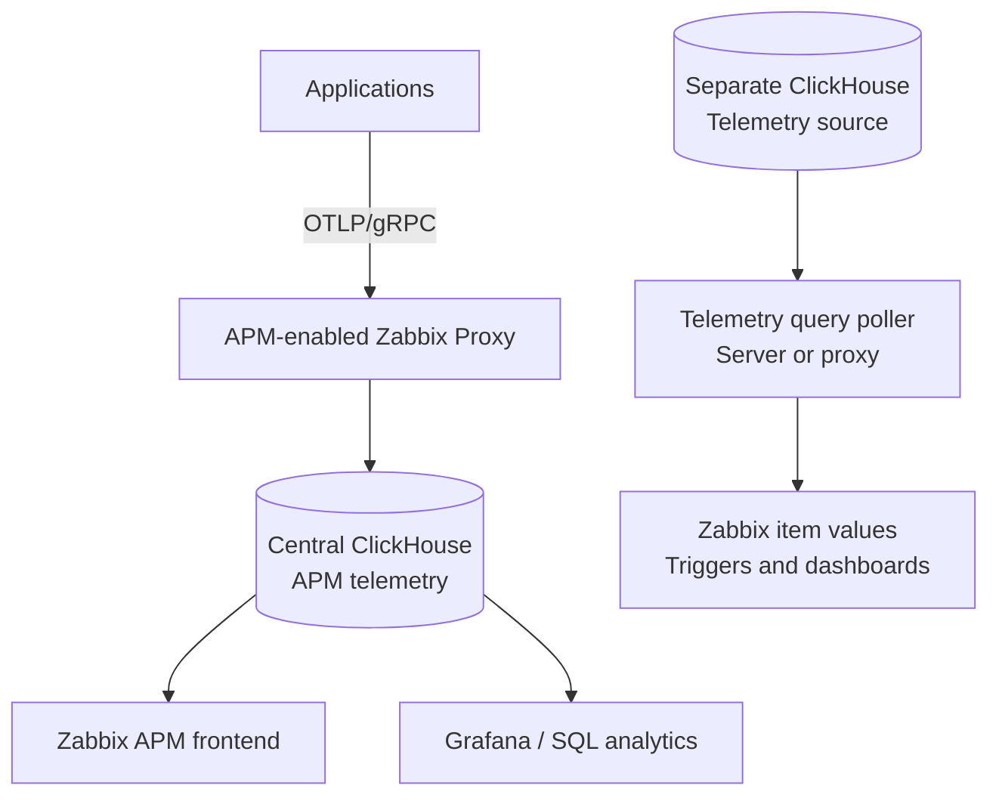

# APM with OpenTelemetry

Zabbix 8.0 introduces application performance monitoring (APM) based on
OpenTelemetry. Alongside infrastructure monitoring, Zabbix can now display
application traces, metrics, and logs, and turn selected telemetry into ordinary
item values for triggers and dashboards.

This chapter explains the architecture and provides a hands-on lab using the
Zabbix proxy's built-in APM collector. It also introduces alternative ingestion
and visualisation options without turning the chapter into an OpenTelemetry or
Grafana installation guide.

We assume a working ClickHouse instance. ClickHouse installation is covered in
Chapter 13, Advanced setup and security.

---

## How APM works in Zabbix

OpenTelemetry is an open standard for producing and exporting three kinds of
telemetry:

- **Traces:** spans describing how requests move through services.
- **Metrics:** measurements such as request counts, latency, and error rates.
- **Logs:** structured event records.

### Understanding OTLP and gRPC

**OTLP (OpenTelemetry Protocol)** defines how OpenTelemetry traces, metrics, and
logs are encoded and exchanged between applications, collectors, and backends.
It supports two transport options:

| Transport | How it works | Default port |
|---|---|---|
| **OTLP/gRPC** | gRPC over HTTP/2, using Protocol Buffers | TCP 4317 |
| **OTLP/HTTP** | HTTP requests with Protocol Buffers or JSON | TCP 4318 |

**gRPC** is a remote procedure call framework that lets services exchange
structured messages. OTLP/gRPC uses it as the transport for telemetry data.
**OTLP/HTTP is not deprecated**: both transports remain supported by
OpenTelemetry. However, the **Zabbix 8.0 proxy APM collector receives
OTLP/gRPC**, not OTLP/HTTP. Applications configured to export OTLP/HTTP must
switch to OTLP/gRPC or send data through an OpenTelemetry Collector that
receives HTTP and forwards it using gRPC.

For this lab, use **OTLP/gRPC on port 4317** when sending telemetry directly
to the Zabbix proxy. See the
[https://opentelemetry.io/docs/specs/otlp/](https://opentelemetry.io/docs/specs/otlp/)
for transport details.

Applications, or an intermediate OpenTelemetry Collector, can send OTLP/gRPC
to the APM collector built into a Zabbix proxy. The proxy writes the received
telemetry directly to ClickHouse. **The Zabbix server does not receive OTLP.**
The frontend reads telemetry from ClickHouse and exposes `APM` | `Traces`,
`APM` | `Metrics`, and `APM` | `Logs`.

Zabbix uses three distinct data paths:

1. **Ingestion:** applications send OTLP/gRPC to the proxy APM collector,
   which writes raw telemetry directly to ClickHouse. Alternatively, an
   external OpenTelemetry Collector can populate a compatible ClickHouse
   schema without using the Zabbix proxy.
2. **Visualisation:** the Zabbix frontend queries ClickHouse for the built-in
   APM views. These requests do not pass through the Zabbix proxy.
3. **Alerting:** a *Telemetry query* item periodically reads ClickHouse and
   converts its result into a regular Zabbix item value. The Zabbix server
   executes the query for directly monitored hosts; a proxy executes it for
   hosts monitored through that proxy. The resulting item value enters normal
   Zabbix history storage and can be used by triggers and graphs.



The diagram is simplified: when the server executes a Telemetry query, its
result is handled locally rather than being forwarded from a proxy. A proxy
that executes a query forwards **only the resulting item value** through the
normal proxy-server monitoring path, not the raw traces, metrics, or logs.
Zabbix does not evaluate triggers directly against raw ClickHouse telemetry.
Telemetry query items bridge the telemetry store and the existing trigger
engine. They are periodic checks, not streaming alerts.

If you use ClickHouse for classic Zabbix item history as well, distinguish
**HistoryProvider** (item history) from **TelemetryProvider** (APM telemetry).
They serve different purposes even when they point to the same ClickHouse
installation.

---

## Architecture considerations for distributed environments

APM introduces a separate network and storage path. Traditional active proxies
send collected monitoring values to the Zabbix server, normally on TCP 10051.
The APM collector instead writes raw telemetry **directly to ClickHouse**. It
does not forward those raw traces, metrics, or logs through the normal
proxy-server connection. Results of *Telemetry query* items still follow the
ordinary Zabbix monitoring path.



The ClickHouse endpoint can be local or remote. For a central APM deployment,
every proxy ingesting telemetry needs a network path to the selected ClickHouse
endpoint. This matters especially for MSPs and customer-site proxies behind
firewalls: TCP 10051 alone is not sufficient.

A local ClickHouse instance avoids the proxy-to-central-ClickHouse write path,
but it does **not** automatically replicate telemetry to the central store.
The frontend and query pollers need access to the data source they query, or
an independently designed replication or forwarding mechanism. ClickHouse is
**not supported as the proxy's normal history database**.

Plan TLS, access controls, availability, network connectivity, and retention for
this separate pipeline. The Zabbix housekeeper does not remove ClickHouse data;
configure retention in ClickHouse itself.

### Central APM storage and other telemetry data sources

The **global telemetry data source** in `Administration` | `Data source` is the
default shared by Zabbix server, proxy, and frontend. It is used by the built-in
APM views, and by Telemetry query pollers unless their component configuration
overrides it.

**This is not a requirement to put all telemetry in one central database.**
A server or proxy can use a different `TelemetryProvider` connection, including
a different ClickHouse database or instance, for the Telemetry query items it
executes. A frontend can also be configured to use a different telemetry data
source. These are **component-level configurations**, not a separate database
selector on every Telemetry query item.

For example, a central ClickHouse database can serve the Zabbix APM views,
while a separate ClickHouse instance holds application-specific data queried by
items executed on a dedicated proxy. Each data source can have its own schema,
retention, and access policy, provided its data is compatible with the queries.



The second ClickHouse source is optional and independent. It is not populated
by the first one automatically.

### Alternative: OpenTelemetry Collector

The built-in proxy collector is the simplest route for this lab. For more
advanced processing, an OpenTelemetry Collector can receive telemetry, apply
processors, and export it to a compatible ClickHouse destination. The exporter
and schema must match what Zabbix expects.

| Capability | Zabbix proxy APM collector | OpenTelemetry Collector |
|---|---|---|
| Receive OTLP/gRPC | Yes | Yes, with OTLP receiver |
| Write to ClickHouse | Through `TelemetryProvider` | With a configured compatible exporter |
| Add resource attributes | Yes, through proxy APM settings | Yes, through processors |
| Filter or transform telemetry | Limited built-in controls | Configurable processors |
| Sampling of traces | No comparable general-purpose pipeline | Available through suitable processors |
| Configure aggregation or histogram processing | Not a general-purpose processing pipeline | Possible with suitable connectors/processors; depends on input data |
| Route to multiple destinations | Not a general-purpose routing pipeline | Supported through configured pipelines/exporters |
| Configuration effort | Lower | Higher |

The proxy can already attach **static resource attributes** to incoming traces,
metrics, and logs. The OpenTelemetry Collector becomes useful when attributes
must be derived from the telemetry itself. For example, the following
**configuration fragment** adds a team attribute only to metrics from the
`checkout` service:

!!! example "Example"

    ```yaml
    processors:
      transform/assign_team:
        metric_statements:
          - context: resource
            statements:
              - set(attributes["team"], "payments") where attributes["service.name"] == "checkout"
    ```

Unlike a static attribute configured on the Zabbix proxy, this rule checks
the incoming `service.name` resource attribute before making a change. It
requires the Collector's **transform processor** and must be included in the
metrics service pipeline to take effect. This is a fragment, not a complete
Collector configuration. OpenTelemetry calls these values *attributes*;
they are similar to Prometheus *labels*. The complete Collector setup is
outside the scope of this book.

### Alternative APM visualisation

ClickHouse stores queryable telemetry data. The built-in Zabbix APM frontend is
not the only way to inspect it: other tools, such as Grafana with a ClickHouse
data source, can query the same tables directly.

| Capability | Zabbix APM frontend | Grafana with ClickHouse |
|---|---|---|
| View traces | Built-in Traces view | Possible with suitable queries and trace-compatible views |
| View metrics | Built-in Metrics view | Custom metrics visualisations |
| View logs | Built-in Logs view | Custom log queries and visualisations |
| Custom dashboards | Zabbix dashboards and item-based widgets | Extensive dashboard customisation |
| Direct custom ClickHouse SQL | Not the focus of the built-in APM views | Yes, through the ClickHouse data source |
| Custom aggregations | Supported Telemetry query aggregations | ClickHouse SQL aggregations |
| Zabbix triggers and actions | Via Telemetry query items | Not a replacement for Zabbix triggers/actions |

Grafana does not automatically reproduce every feature of a dedicated tracing
backend. Trace navigation and cross-signal correlation depend on the available
data, queries, plugins, and visualisations. The point is that **the telemetry
storage is reusable**; you are not required to visualise it only in Zabbix.

---

## Setting up the Zabbix side

### 1. Proxy configuration (receiving OTLP data)

On the proxy receiving OpenTelemetry traffic, create
`/etc/zabbix/zabbix_proxy.d/telemetry.conf` (assuming your proxy configuration
loads files from that directory):

!!! info ""

    ```conf
    StartAPMCollectors=1
    APMListenPort=4317
    TelemetryProvider=clickhouse;url=http://clickhouse.example.com:8123,db=zabbix,username=zabbix,password=your_password
    ```

- `StartAPMCollectors=1` enables the collector process; the default is `0`.
- `APMListenPort=4317` uses the conventional OTLP/gRPC port. By default the
  collector listens on all interfaces; set `APMListenIP` to restrict it.
- `TelemetryProvider` configures the ClickHouse connection, with `clickhouse;`
  followed by comma-separated options. For this proxy, it also supplies the
  default data source for Telemetry query pollers.

Restart the proxy. For incoming OTLP TLS, consult `APMTLSCAFile`,
`APMTLSCertFile`, and `APMTLSKeyFile` in the proxy parameter reference. For TLS
from the proxy to ClickHouse, use the documented `ssl_*` provider options.

To obtain credentials from Vault, use `vault_path` instead of the inline
`username` and `password`, and configure the required Vault settings on the
same component.

In `Administration` | `Proxies`, open the proxy's **APM** tab and enable data
collection. You can also configure message-rate limits and additional resource
attributes, such as `environment=lab`.

### 2. Global data source for the frontend

Open `Administration` | `Data source` | `APM`, enable the global telemetry data
source and configure the ClickHouse connection. For this lab, point it to the
same database that receives telemetry from the proxy. The built-in APM views
query this source directly.

### 3. Telemetry queries on server or proxy

*Telemetry query* items are executed by the component monitoring the host.
`StartTelemetryQueryPollers` defaults to **1** on server and proxy. Increase
it only if the query workload requires more workers, and ensure it is not `0`.

On a server that needs to query ClickHouse, configure its telemetry data source,
for example:

```conf
TelemetryProvider=clickhouse;url=http://clickhouse.example.com:8123,db=zabbix,username=zabbix,password=your_password
```

The proxy configuration shown earlier already covers both its APM ingestion
and its own Telemetry query pollers. If the global data source is configured,
remember that a component-level provider setting overrides that default.

---

## Telemetry query items in brief

A *Telemetry query* item asks the configured data source for selected telemetry
and returns the result as a normal Zabbix item value.

| Parameter | What it does |
|---|---|
| **Category** | Traces, Metrics, or Logs |
| **Metric points** | For Metrics: Sum, Gauge, Histogram, or Exponential histogram |
| **Columns** | Include selected raw columns |
| **Aggregated columns** | Calculate min, max, avg, count, sum, or percentile; provide aliases for results |
| **Conditions** | Filter records, including matching keys in attribute maps |
| **Type of calculation** | Combine conditions using And/Or, And, Or, or a custom expression |
| **Granularity** | Duration of each aggregation bucket, for example `1m` |
| **Time shift** | Move the end of the query range into the past, allowing late telemetry to arrive |
| **Lookback limit** | Maximum catch-up range after a delayed or interrupted query; not the normal query duration |

### Understanding query timing and aggregation

Telemetry query items run at their **Update interval**, but one execution can
produce several aggregated time buckets. The four timing settings serve
different purposes:

| Setting | Example | Effect |
|---|---|---|
| Update interval | `15m` | Run the query every 15 minutes |
| Time shift | `5m` | Leave the newest five minutes for telemetry to arrive |
| Lookback limit | `20m` | Limit how far a delayed query can catch up |
| Granularity | `1m` | Aggregate each minute separately |

For example, at **12:00**, after a successful run at **11:45**, a query with
these settings normally processes telemetry from **11:40 to 11:55**. The
five-minute time shift excludes the newest data. With one-minute granularity,
this 15-minute range contains **15 buckets per group**. The query can calculate
several functions, such as count and maximum duration, for each bucket.

Zabbix continues from its saved query position after a successful run. If
polling is interrupted, the lookback limit caps the amount of older data it
tries to recover. It does **not** make every normal query 20 minutes long.

Depending on the timing settings, consecutive query ranges can be adjacent
(**tumbling**), overlap (**hopping**), or have gaps (**hopping with gaps**).
These are descriptions of the resulting query ranges, not separate modes
selected in the item configuration. In particular, gaps can leave telemetry
outside the queried ranges, while overlaps can query some telemetry more than
once. Choose the settings with the desired coverage in mind.

The **Columns** setting groups records by selected fields, such as
`ServiceName` or `SpanName`. **Aggregated columns** define calculations
such as count, maximum, or percentile, with a distinct alias for each result.
**Conditions** filter records *before* grouping and aggregation. Thus one
query can conceptually calculate multiple results for each group and time
bucket. The exact serialization of those results into a Zabbix item value
is subject to the RC3 changes discussed below.

For traces, commonly useful columns include `Duration`, `ServiceName`,
`SpanName`, `StatusCode`, `SpanAttributes`, `ResourceAttributes`, `TraceId`,
`SpanId`, and `Timestamp`. The exact supported column list is in the official
*Telemetry query* reference.

| Trace column | Raw columns | Aggregation | Conditions |
|---|:---:|:---:|:---:|
| Duration | ✓ | ✓ | – |
| ServiceName | ✓ | – | ✓ |
| SpanName | ✓ | – | ✓ |
| StatusCode | ✓ | – | ✓ |
| SpanAttributes | ✓ | – | ✓ |
| ResourceAttributes | ✓ | – | ✓ |
| ParentSpanId | ✓ | – | ✓ |
| TraceId / SpanId | ✓ | – | ✓ |
| Timestamp | ✓ | ✓ | – |

Set **Type of information** to match the value returned by the item after
any preprocessing. For the numeric latency example below, use Numeric (float).
Multiple aggregated columns and grouping are already available in the query
configuration. **JSON output for using one query as a master item with
multiple dependent items is planned for RC3**, so the example below retains
a single p95 aggregation until the RC3 output format is tested.

If a host moves to another proxy, the query component may lose its
previous query boundary and produce duplicate values. Keep this in mind for
proxy groups and other failover designs.

---

## Lab: generate traces and alert on span latency

This lab generates sustained OpenTelemetry traces, confirms that Zabbix can
read them, then builds a Telemetry query item and a trigger. No real application
is needed.

### Prerequisites

- A proxy with APM collector enabled, configured, and restarted.
- A working ClickHouse instance with the required OpenTelemetry tables.
- A global data source configured for the frontend APM views.
- A server or proxy with working Telemetry query pollers and access to ClickHouse.
- Network access to the proxy's OTLP/gRPC port and to ClickHouse.

### Initializing the ClickHouse APM schema

Before collecting OpenTelemetry data, the required ClickHouse tables must be
created. Zabbix provides an initialization script for traces, metrics, and
logs in the following directory:

!!! info ""

    ```text
    /usr/share/zabbix/sql-scripts/clickhouse/
    ```

Run the `otel_all.sh` script to create the required tables:

!!! info ""

    ```bash
    cd /usr/share/zabbix/sql-scripts/clickhouse/
 
    ./otel_all.sh \
      --server http://localhost:8123 \
      --db zabbix
    ```

If ClickHouse requires authentication, provide the `--user` and `--password`
parameters. The script also supports TLS connections and custom retention
settings.

By default, the OpenTelemetry tables use the `MergeTree` engine with a
retention period of **31 days**. The script creates separate tables for traces,
logs, and the supported OpenTelemetry metric types.

Verify that the tables were created successfully:

!!! info ""

    ```bash
    clickhouse-client --query "
    SELECT name, engine
    FROM system.tables
    WHERE database = 'zabbix'
      AND name LIKE 'otel_%'
    ORDER BY name"
    ```

The expected tables are:

| Table | Purpose |
|---|---|
| `otel_traces` | Distributed traces and spans |
| `otel_logs` | OpenTelemetry logs |
| `otel_metrics_gauge` | Gauge metrics |
| `otel_metrics_sum` | Sum metrics |
| `otel_metrics_histogram` | Histogram metrics |
| `otel_metrics_exponential_histogram` | Exponential histogram metrics |

The initialization scripts are also available in the official
[https://github.com/zabbix/zabbix/tree/master/database/clickhous](https://github.com/zabbix/zabbix/tree/master/database/clickhouse).

!!! note "Telemetry retention"

    OpenTelemetry data is retained according to the TTL configured in
    ClickHouse. The Zabbix housekeeper does not manage this data.
    Adjust the retention period using the `--ttl` parameter when
    initializing the tables.

### Step 1: Configure the global APM data source

In `Administration` | `Data source` | `APM`, enable the global data source and
enter the ClickHouse URL and credentials. It must point to the database used by
the proxy for this lab.

### Step 2: Generate sustained baseline traces

Install OpenTelemetry's `telemetrygen` tool with Go, or use a container image.
Pin a version tested in your environment. For example:

!!! info ""

    ```bash
    go install github.com/open-telemetry/opentelemetry-collector-contrib/cmd/telemetrygen@v0.120.0
    ```

Container alternative:

!!! info ""

    ```bash
    docker run --rm ghcr.io/open-telemetry/opentelemetry-collector-contrib/telemetrygen:0.120.0 \
      traces --help
    ```

A short burst is insufficient for stable time buckets and a three-minute
trigger average. Generate several minutes of baseline spans at roughly 200 ms:

!!! example "Example"

    ```bash
    telemetrygen traces \
      --otlp-endpoint zabbix-proxy.example.com:4317 \
      --otlp-insecure \
      --service checkout \
      --rate 5 \
      --duration 5m \
      --child-spans 2 \
      --span-duration 200ms
    ```

Each trace contains a root span and child spans. **Duration is per span**, not
per complete trace. `--otlp-insecure` is suitable only for an isolated lab;
configure TLS for production.

### Step 3: Confirm traces in the APM menu

Open `APM` | `Traces`, select the last 15–30 minutes and filter on
`ServiceName = checkout`. You should see traces and be able to inspect spans.

If the list is empty, inspect the proxy log, collector enablement, the proxy's
`TelemetryProvider`, the frontend data source, ClickHouse tables, and network
connectivity. Also check that your generator is actually sending OTLP/gRPC.

### Step 4: Create a host

Create a host named `otel-lab`, monitored by the server or proxy that should
execute the Telemetry query. This item type does not require an agent.


_ch4.104 Add new host_

### Step 5: Create the Telemetry query item

Create the following item on `otel-lab`:

| Field | Value |
|---|---|
| Name | Checkout span p95 duration |
| Type | Telemetry query |
| Key | `telemetry.checkout.p95` |
| Category | Traces |
| Aggregated columns | Percentile of Duration, Percentage `95`, Alias `p95` |
| Conditions | `ServiceName` Equals `checkout` |
| Granularity | `1m` |
| Time shift | `2m` |
| Lookback limit | `15m` |
| Update interval | `1m` |
| Type of information | Numeric (float), after preprocessing |
| Units | `ms` |
| Preprocessing | |
| JsonPath | $.columns.p95 |
| Custom multiplier | 0.000001 |


_ch04.105 Create Item_

Use `Test` | `Get value` to inspect the actual result.
Configure preprocessing only for the observed result format; do not
assume a particular JSON structure or JSONPath. Span `Duration` is measured
in nanoseconds in the ClickHouse trace schema, so multiply by `0.000001`
when converting a numeric duration to milliseconds.

### Step 6: Create triggers and raise latency

Create a latency trigger using a short rolling average:

!!! info ""

    ```text
    avg(/otel-lab/telemetry.checkout.p95,3m)>500
    ```

For a separate missing-data alert:

!!! info ""

    ```text
    nodata(/otel-lab/telemetry.checkout.p95,10m)=1
    ```

After the baseline run ends, generate slower spans long enough to fill several
one-minute buckets:

!!! example "Example"

    ```bash
    telemetrygen traces \
      --otlp-endpoint zabbix-proxy.example.com:4317 \
      --otlp-insecure \
      --service checkout \
      --rate 5 \
      --duration 10m \
      --child-spans 2 \
      --span-duration 600ms
    ```

Go to `APM`|`Traces` and click on the right side of the screen and drag it to
the middle so you can see the traces.


_ch04.106 APM traces panel_

Avoid overlapping the baseline and slow runs in the same buckets if you want
a clean rise above 500 ms. The latency trigger should activate once sufficient
slow data has been processed. Stop the generator to test `nodata()` separately.

### Step 7: Clean up

Stop the generator and disable or remove the lab host and items. The
*Lookback limit* controls initial/recovery query windows; it does not create
new values when traffic stops.

### What this lab proves

- The proxy accepts OTLP/gRPC telemetry and writes it to ClickHouse.
- Traces are visible in `APM` | `Traces`.
- A Telemetry query can aggregate span duration for a particular service.
- Normal Zabbix triggers can alert on the resulting item values.

---

## Conclusion

Zabbix 8.0 connects application telemetry with traditional monitoring. The
built-in proxy APM collector is a practical starting point, while the
OpenTelemetry Collector offers more elaborate processing when needed. The
ClickHouse storage layer can also serve other analytics and visualisation
tools, including Grafana; it is not restricted to the Zabbix frontend.

Remember the architectural distinction: raw telemetry is ingested directly
into ClickHouse, whereas Telemetry query results become ordinary Zabbix item
values. For distributed deployments, plan the telemetry network path,
retention, security, and data-source configuration separately from the normal
proxy-server monitoring connection.

---

## Questions

1. What are the three OpenTelemetry signal types, and how does Zabbix use them?
2. Why does the Zabbix proxy receive OTLP while the Zabbix server does not?
3. What additional network paths does APM introduce for remote proxies?
4. How does a Telemetry query result become usable in a Zabbix trigger?
5. Must the ClickHouse database used by the built-in APM frontend also be the
   data source for every Telemetry query poller?

---

## Useful URLs

- [https://www.zabbix.com/documentation/8.0/en/manual/config/items/itemtypes/telemetry_query](https://www.zabbix.com/documentation/8.0/en/manual/config/items/itemtypes/telemetry_query)
- [https://www.zabbix.com/documentation/8.0/en/manual/web_interface/frontend_sections/administration/data_source](https://www.zabbix.com/documentation/8.0/en/manual/web_interface/frontend_sections/administration/data_source)
- [https://www.zabbix.com/documentation/8.0/en/manual/concepts/proxy/distributed_monitoring](https://www.zabbix.com/documentation/8.0/en/manual/concepts/proxy/distributed_monitoring)
- [https://www.zabbix.com/documentation/8.0/en/manual/config/templates_out_of_the_box/otlp](https://www.zabbix.com/documentation/8.0/en/manual/config/templates_out_of_the_box/otlp)
- [https://www.zabbix.com/documentation/8.0/en/manual/appendix/install/clickhouse_setup](https://www.zabbix.com/documentation/8.0/en/manual/appendix/install/clickhouse_setup)
- [https://github.com/zabbix/zabbix/tree/master/database/clickhouse](https://github.com/zabbix/zabbix/tree/master/database/clickhouse)
- [https://opentelemetry.io/docs/specs/otlp/](https://opentelemetry.io/docs/specs/otlp/)
- [https://opentelemetry.io/docs/what-is-opentelemetry/](https://opentelemetry.io/docs/what-is-opentelemetry/)
- [https://opentelemetry.io/docs/collector/](https://opentelemetry.io/docs/collector/)
