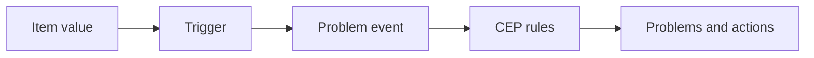
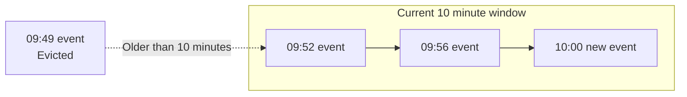
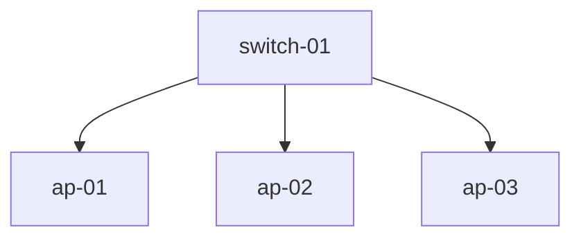

# Complex event processing

When we start monitoring more and more devices, we also start generating more
and more events. Of course, this is exactly what we want Zabbix to be doing, but it can introduce a new problem. A single device failure might result in tens, maybe even hundreds of problems

For example, let's say a network switch with several access points
connected behind it goes down. When the switch goes down, all of
the access points connected to that switch will become unavailable as well
and generate a problem in Zabbix. In this case the switch is the actual
cause, while the access point problems are only symptoms of that same failure.

This is where `Complex event processing`, or `CEP` is going to make a
big difference in. CEP was added in Zabbix 8.0 to avoid alert fatigue
from many problems related to a single other problem. We can use CEP to
group events together, instead of looking at every event as a completely
separate problem.

---

## The basics

As we have learned, normally a trigger evaluates our item values and
generated a problem event. This is then seen as a problem when we look
at our dashboards or `Monitoring` | `Problems`. This fact does not
change with CEP. CEP only starts working when the problem event has been
created, using CEP we can decide what should happen with the problem event
before it executes things like Actions to send out alerts.

You can think of the event flow as follows:



A CEP rule consists the following important parts:

- **Conditions** define which events should be processed by the rule
- **Time window processing** defines how matching events are kept together within time windows
- **Operations** define what Zabbix should do with matching events
- **Sort order** defines the order in which multiple CEP rules are executed
- **Stop after this rule** prevents later CEP rules from processing the event

CEP rules are executed in their configured sort order. Changes made by an
earlier rule their operations (such as adding a tag), are visible to rules executed afterward.

{ align=center }

_7.5 Event processing overview_

These are only the basics, as we can get more options through `Simple (multipe)`, `Simple (once)`, `Cause and symptom grouping` and `Pattern match`.

---

## Sliding time windows

The most important CEP concept to understand is the `sliding time window`.
When problem events start, they are added to the CEP window, which is
not a fixed block from 09:00 until 09:10 and then another block from
09:10 until 09:20. Instead, the window starts only as the problem event enters
the CEP rule and then moves forward in time.

Let's say we configure a window duration of `10m`, the Zabbix CEP rule
will keep looking at the events from the most recent ten minutes.
New events enter the window, while events older than ten minutes
leave it. Leaving a window is called `eviction`.



A window can also be configured to have a limited `Capacity`.
For example, a capacity of `5` means that only five events
can be in the window at any given time. When a sixth event
enters, an older event has to be evicted. Setting the capacity
to `Unlimited` means that the duration of the entire CEP 
window controls when events leave the window.

Depending on the processing type, we can also create separate
windows by creating groupings based on:

- **Host group**
- **Host**
- **Tag**

Grouping by a tag is especially useful when events from different hosts belong
to the same service, location, or a failure domain. We can use this to relate problems from different hosts and/or triggers to each other.

---

## Time window processing options

Zabbix provides several CEP processing options. They all start
with matching events, but the different processing options
handle those events differently.

### None

The `None` option processes single events without placing them in a time
window. It is always executed directly when a problem starts. This is
specifically useful when we want to add additional information to an event
immediately, for example by changing the severity or by adding a tag.

### Simple

There are two `Simple` options to choose from in Zabbix CEP rules.
Both `Simple (multipe)` and `Simple (once)` place matching events
in a sliding time window. Our events will leave the CEP window when
they reach the configured duration or when the window
reaches its capacity.

While an event is in the window, Operations can be executed.
Specifically when the event occurs, is added to the window, is
evicted from the window, or when the window closes specific operations
can be executed.

The main use case of the two `Simple` processing types:

- **Simple (multiple)** allows the same event to enter every matching
  `Simple (multiple)` rule. Use this when several independent CEP rules need
  to process the same event.

- **Simple (once)** allows the event to enter only the first matching
  `Simple (once)` rule. The CEP sort order becomes important in this mode. Place
  the most specific rule first and more general fallback rules afterwards.

Think of `Simple (once)` as an `if / else` chain, while `Simple (multiple)`
is more like a catch-all rule allowing every matching rule to run.

These CEP types are useful for rate limiting problems, deduplicating problems,
automatically closing problems after a certain time, or applying different
processing based on the age or number of events in the window.

One use case that it is particularly useful is suppressing duplicate problems,
suppressing problems like ping down or port issues. Specifically when there
is a cause/symptom relation but you might not want to use cause/symptom grouping.

### Cause and symptoms grouping

The `Cause and symptoms grouping` option groups related problems together. In
older Zabbix versions is was already possible to create a cause/symptom relationship
manually, with CEP we can now automate that process. This works by adding the
first event in a window as the cause. Events arriving afterwards become
symptoms of that cause.

No operations are required for this processing type. The cause and symptom
relationship is created automatically. It is however smart to use the
`Group by` feature to match specific events correctly.

Keep in mind that CEP does not automatically understand your infrastructure.
This CEP rule type is first come first serve, meaning the first event will always
be the cause. If we are trying to build a topology based cause/symptom relation
and a downstream device reports its problem before the actual upstream failure,
the downstream event will incorrectly become the cause. In our topology example with
a switch and access point, we would have to account for that making sure the switch
problem is detected first.

### Pattern match

The `Pattern match` option is by far the most complex of Complex Event Processing
options. It uses JavaScript to inspect the events in a sliding time window.
Only when the script returns a match, will Zabbix execute the configured
operations.

Besides being more complex, Pattern matching is the most flexible option. 
We can use it to detect event sequences, repeated events, missing events, or even
more advanced cause and symptom logic. It is also the option that requires the
most careful testing as you will need to build the correct Javascript logic for
matching events consistently.

---

## CEP operations

Operations can run at several moments during the lifetime of a window, which
depends on what `Execute when` is set to. The available execution points depend
on the CEP time window type, but we can usually pick from:

- **When an event occurs**
- **When an event is evicted**
- **When an event is closed**
- **When a window is closed**
- **When tags are correlated**
- **When a pattern is matched**

Operations are useful to change information on an event like its name or severity.
We can also use it to close or discard an event, suppress or unsuppress it, create
a copy, and add, change, rename, or remove tags. Within our CEP rule we can define multiple operations, each with its own conditions.

For simple cause and symptom grouping we do not need any operations, so without
further ado, let's build a small example.

---

## Switch and access point example

For this example we have one network switch with three access points connected
behind it:



If `ap-01` goes down, we want to retain our traditional Zabbix logic and see the
problem for the access point come up on our dashboards. However, if the switch
goes down, we want the switch to become the cause and the three access points to
become symptoms of the switch down problem.

To make automated cause/symptom grouping like this available, it will be very important
to keep information in your Zabbix environment structured. Either through correct
host grouping or more likely tags. For this example let's add the following host tag
to the switch and all three access points:

```text
failure_domain=edge-01
```

`failure_domain` : `edge-01` in this case will represent this specific edge
network, where the switch and access points reside in together. 

Since Host tags are inherited by problem events, we can add the tags to the hosts
directly, making it easy to see them in our overviews later. Having the host tags
available on the problem event means the CEP rule can use this tag without
adding it to every trigger separately.

Next, we add the following trigger tag to the availability trigger that should be
processed by CEP:

```text
scope=cep
```

This is usually a trigger such as `ICMP Down`, on both devices. The `Scope` : `cep`
tag is our opt-in tag. A trigger without `scope=cep` will not be processed by 
the CEP rule in this example, giving us granular control over which problems will 
be processed by CEP

{ align=center }

_7.6 CEP host and trigger tags_

### Making the switch faster

Since Cause and symptoms grouping uses the first matching event as the cause, we
need the switch problem to be generated before the access point problems.

That means we need to take this into account when defining our templates. We 
can do something like the below on our triggers.

```text
Switch trigger:       max(/switch-01/icmpping,3m)=0
Access point trigger: max(/ap-01/icmpping,5m)=0
```

Let's say both icmpping items have an update interval of 1 minute, this means that 
the switch will always be detected before the access point.

The switch needs 3 minutes worth of failed values, three values in total. While
an access point will need at least 5 minutes worth of failed values, 5 in total. We 
can apply this logic to all access points, by setting up our templates in a smart 
manner.

The difference does not have to be large, as our goal is simply to make the
event order predictable.

### Creating the CEP rule

Next up, we can finally start creating our CEP rules. It's important to have our 
logic all setup before we do this. Since we have our logic defined, let's 
navigate to `Alerts` | `Event processing` and click on `Create complex event processing`.

Let's configure the rule as follows:

- **Name**: `Network edge failure domain`
- **Conditions**: Tag value `scope` equals `cep`
- **Conditions**: Tag name equals `failure_domain`
- **Time window processing**: `Cause and symptoms grouping`
- **Duration**: `10m`
- **Capacity**: `Unlimited`
- **Group by**: `Tag` : `failure_domain`

In this specific case, operations can remain empty as the Cause and symptoms grouping 
cep rule type will create the relation for us automatically.

{ align=center }

_7.7 CEP switch rule configuration_

Since we are matching on the generic tag `failure_domain`, we can use this CEP rule for
many more failure domains, not just `edge-01`. This immediately shows use the flexibility of 
the new CEP functionality, as we can group many different problems with only one CEP rule.

### Testing the result

We are now ready to do our first test, by making `ap-01` unavailable. The problem event for
the access point will be the first and only event in the `edge-01` window, so it will be shown as the cause.

When we recover the access point we do need to make sure to wait for the original window to
close (10m) before starting the next test. If the CEP time window hasn't closed yet, the `switch-01` problems could become a symptom of `ap-01` problem. 

Once the ap-01 problem has resolved and the window has closed (or if you used the 
`Reset time windows` button on the CEP rule make `switch-01` and `ap-01` unavailable 
(in that order). The switch event should now be created first, meaning that when the 
access point event follows, they are added as symptoms of the switch problem.

The result should look like this:

```text
switch-01 is unavailable            Cause
|- ap-01 is unavailable             Symptom
|- ap-02 is unavailable             Symptom
`- ap-03 is unavailable             Symptom
```

{ align=center }

_7.8 Switch cause with access point symptoms_

### A very important limitation

Having our triggers set up correctly means that the delay is predictable, but 
it does not make CEP aware of the actual topology. If an access point problem 
is already open when the switch fails, the access point can remain the cause 
because it entered the window first. Correct template/trigger configuration is 
as such very important when using this CEP type.

For production topology correlation, we can also use explicit topology tags 
and a pattern match CEP rule that identifies the cause event using the tags. 
This requires more configuration, but it removes the dependency on event 
order. We can make it as complex as we'd like.

---

## Conclusion

Complex event processing allows us to deduplicate or adjust existing Zabbix 
problem events instead of handling a huge list of separate problems 
manually. Sliding time windows keep recent events together, while conditions, 
grouping, and operations determine how those events should be processed.

One of the most anticipated options, automatic Cause and symptoms grouping 
gives us a quick way to group network topology related problems like a switch 
failure with the endpoints behind it. We just need to remember the most important 
rule for cause/symptom grouping: the first event in the window becomes the cause. 
For a simple topology we can control that with trigger timing. For larger production 
environments, explicit topology information and pattern matching to supress problems 
is usually a safer solution.

---

## Questions

- What is the difference between a fixed interval and a sliding time window?
- What can cause an event to be evicted from a CEP window?
- Which CEP processing type automatically creates cause and symptom relations?
- Why does detection order matter in cause and symptom grouping?
- Why do we use a shared failure-domain tag in the switch example?

---

## Useful URLs

- 
