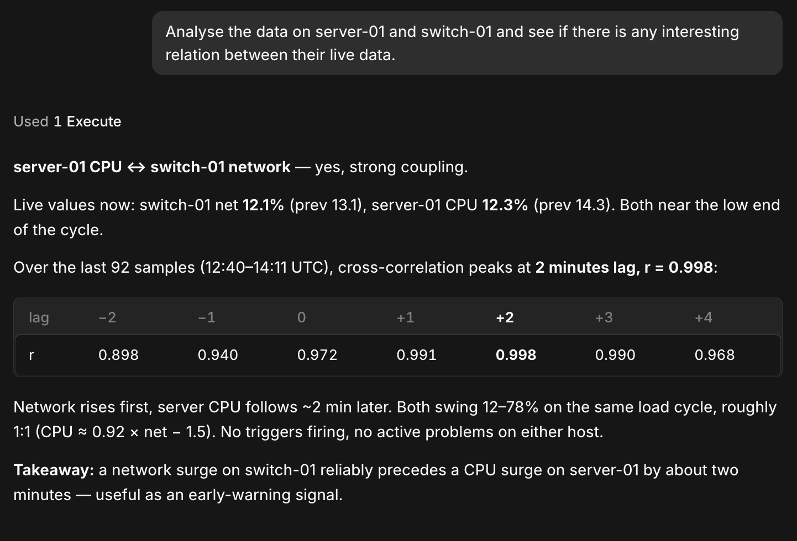

# Zabbix MCP server

The world of IT will never be the same with the introduction of AI assistants. Cloud-based and locally running AI have both been shown to be valuable resources for IT engineers and developers. However, we usually still lack a way to interface with our various applications cleanly.

This is where the Model Context Protocol (MCP) comes in. It's an open-source standard that allows us to interface applications like Zabbix with AI applications like Claude, ChatGPT or any supported application you might be running.

The idea is simple. By introducing an open-source protocol that is widely supported by AI applications, we can easily integrate one or multiple AI applications. This is especially useful to control what an AI application can do with your data, instead of just handing over API keys and letting AI run its course. It's easier, faster and more secure.

## What you can do with the Zabbix MCP server

For AI applications to interface with our Zabbix environment, we will need three things:

1. The MCP Server Layer: Provided by the `zabbix-mcp-server` package, it acts as a secure bridge receiving HTTP requests from the AI application's client.
2. The MCP Client Layer: Built into the AI application, the MCP client establishes and manages communication with the Zabbix MCP server. It discovers available tools, sends requests, and returns the results to the AI application.
3. The MCP Host Layer: This is the AI application itself, such as Claude Desktop, ChatGPT, Cursor, or Visual Studio Code. It provides the interface through which users interact with the AI, interprets their requests, and uses the MCP client to access Zabbix functionality.

???+ note
    Important Zabbix detail: The MCP server is a separate process, not part of the Zabbix server daemon. It communicates with the Zabbix frontend API, while the MCP client runs within the AI application. Each request uses a Zabbix API token, and access is further restricted by the token owner's permissions.

Once we have the three layers prepared, we can start using our AI applications to request data from or execute actions in Zabbix. In Zabbix 8.0, what we can do is limited to:

- Monitoring data: Retrieve hosts, host groups, templates, items, triggers, problems, and historical data.
- Problem management: Acknowledge, comment on, close, suppress, or change the severity of problems.
- Maintenance management: Create, modify, or delete maintenance periods.

## Preparing your environment

Before installing the Zabbix MCP server, consider where you would like to run it. The MCP server can run on the Zabbix server itself or on a completely separate machine.

Make sure the following requirements are met:

- Network connectivity: The Zabbix MCP server must be able to reach the Zabbix frontend API, while the AI applications' MCP clients must be able to reach the MCP server.
- API authentication: Each user needs a Zabbix API token with the appropriate permissions.
- Access control: Determine which MCP clients can connect and which tools they are allowed to execute.
- Encryption: Use HTTPS/TLS to protect communication and API tokens.

For security reasons, it is recommended to start with read-only permissions and enable write operations only when necessary.

## Installing and configuring the MCP server

To install the Zabbix MCP server, we need to log in to the CLI of the machine where we'd like to install it. For this example, we will be installing it on the same server where our Zabbix server and frontend are already running (single-server setup).

!!! info "Install Zabbix MCP server"
    Red Hat-based

    ```bash
    dnf install zabbix-mcp-server
    ```

    Debian-based

    ```bash
    apt install zabbix-mcp-server
    ```

    SUSE Linux Enterprise / openSUSE

    ```bash
    zypper install zabbix-mcp-server
    ```

After this is done, we are ready to configure the Zabbix MCP server. It comes with its own configuration file, by default located at `/etc/zabbix/zabbix_mcp_server.conf`. Let's edit it.

!!! info "Edit Zabbix MCP server configuration"
    ```bash
    vim /etc/zabbix/zabbix_mcp_server.conf
    ```

The configuration file contains several parameters that control how the MCP server communicates with Zabbix and which clients are allowed to connect.

For our single-server setup, we only need to modify the following parameter:

!!! info "Add Zabbix MCP server parameters"
    ```ini
    FrontendURL=https://zabbix.company.com/api_jsonrpc.php
    ```

Replace the URL with the address of your Zabbix frontend API.

There are also several other parameters worth understanding:

- **ListenIP:** Defines the IP address on which the MCP server listens for incoming connections. By default, `0.0.0.0` (all IPv4 interfaces).
- **ListenPort:** Defines the TCP port used by the MCP server. By default, `8443`.
- **AllowedIP:** Restricts which IP addresses are allowed to connect to the MCP server. By default, only localhost (`127.0.0.1,::1`) is allowed. Remote MCP clients require additional addresses to be permitted.
- **MaxResponseSize:** Defines the maximum size of responses returned by the MCP server. By default, `64K`.

For now, we can leave these parameters unchanged if the MCP client runs on the same machine. However, if your AI application connects from a different machine, you will need to adjust `AllowedIP` accordingly and allow access to the MCP server's listening port, `8443` by default.

If you'd like to use cloud-hosted AI tools such as ChatGPT or Claude, you can restrict access to their published outbound IP ranges instead of allowing connections from every IP address.

- **ChatGPT:** OpenAI publishes its connector IP ranges in a [JSON file](https://openai.com/chatgpt-connectors.json), linked from its [IP egress documentation](https://developers.openai.com/api/docs/guides/ip-addresses). Add the listed CIDR ranges to `AllowedIP`.
- **Claude:** Anthropic currently lists `160.79.104.0/21` and `153.61.208.0/20` as its outbound IP ranges, including connections to MCP servers. Check its [IP address documentation](https://platform.claude.com/docs/en/api/ip-addresses) for the latest values.

These ranges can change, so check the provider's documentation regularly and update both `AllowedIP` and your firewall rules when needed.

???+ note "Security considerations"
    Avoid setting `AllowedIP` to `0.0.0.0/0,::/0`, as this permits connections from any IP address. Restrict access to the clients or provider ranges you need and use HTTPS/TLS to protect your API tokens. A provider's IP ranges are shared by its users, so allowing those ranges does not restrict access to your own account. Zabbix API tokens and the associated user permissions are still required to control access to your Zabbix environment.

### Securing the connection with TLS

By default, the Zabbix MCP server accepts unencrypted HTTP connections. Since important data and Zabbix API tokens are transmitted with every request, it is strongly recommended to enable TLS encryption, especially when connecting AI applications over the internet.

The Zabbix MCP server supports TLS natively, meaning we can configure encryption without requiring an additional reverse proxy. First, we need a valid TLS certificate and a matching private key.

For our example, we assume the certificate and private key are located at `/etc/ssl/`.

Open the configuration file again:

!!! info "Configure TLS encryption"
    ```bash
    vim /etc/zabbix/zabbix_mcp_server.conf
    ```

Find the TLS-related parameters and configure them as follows:

```ini
TLSAccept=cert
TLSCertFile=/etc/ssl/certs/mcp-fullchain.pem
TLSKeyFile=/etc/ssl/private/mcp-privkey.pem
```

- **TLSAccept:** Set to `cert` to enable encrypted HTTPS connections.
- **TLSCertFile:** Specifies the path to the TLS certificate or full certificate chain.
- **TLSKeyFile:** Specifies the path to the corresponding private key.

Make sure the certificate and private key exist, are secure and are readable by the `zabbix` user (default). The private key, especially, should not be accessible to other users.

Once TLS is configured and the service has been started, the Zabbix MCP server endpoint will be available over HTTPS.

???+ warning "Certificate validation"
    Always use a certificate trusted by the connecting MCP clients. Self-signed certificates may work in testing environments but require additional trust configuration. The `IgnoreURLCertErrors` parameter only affects certificate validation when the MCP server connects to the Zabbix frontend API. It does not disable certificate validation for incoming MCP client connections.

### Controlling access to tools and sensitive data

For additional control over what we can do from our AI applications, the Zabbix MCP server allows us to control which tools are available. This is particularly useful when we want to prevent AI applications from accessing sensitive information or executing certain actions.

By default, the Zabbix MCP server disables five tools that may expose sensitive information:

- **item_get:** Retrieves item configuration, including item keys and potentially sensitive parameters.
- **lld_get:** Retrieves low-level discovery rules and their configuration.
- **interface_get:** Retrieves host interface information, including IP addresses and DNS names.
- **macro_get:** Retrieves host and global macros, which may contain sensitive information.
- **history_get:** Retrieves historical monitoring data, which may contain sensitive values.

Do not enable these without doing a proper audit of your Zabbix environment first. A lot of Zabbix systems have been upgraded throughout the years and, in general, humans are prone to making mistakes. Old user macros with plain-text passwords, item key parameters with plain-text passwords and other sensitive information might exist in these configuration settings. Make sure they don't before enabling the tooling.

Any restrictions are configured in `/etc/zabbix/zabbix_mcp_server.conf` using the `DenyTool` parameter:

```ini
DenyTool=item_get
DenyTool=lld_get
DenyTool=interface_get
DenyTool=macro_get
DenyTool=history_get
```

If we want to make any of these tools available, we can simply comment out or remove the corresponding `DenyTool` line.

We can also choose to restrict additional tools. For example, if we only want our AI applications to retrieve monitoring information without being able to make changes to Zabbix, we can add more `DenyTool` lines to disable problem management and maintenance operations.

!!! info "Restrict MCP tools to read-only operations"
    ```ini
    DenyTool=problem_acknowledge
    DenyTool=problem_unacknowledge
    DenyTool=problem_annotate
    DenyTool=problem_change_severity
    DenyTool=problem_close
    DenyTool=problem_suppress
    DenyTool=problem_unsuppress
    DenyTool=maintenance_create
    DenyTool=maintenance_update
    DenyTool=maintenance_delete
    ```

Alternatively, we can use `AllowTool` and `DenyTool` together to explicitly define which tools are available. Rules are evaluated in the order in which they are defined in the configuration file, with the first matching rule being applied.

For example, to expose only tools related to hosts and problems, we can add a configuration like the one below.

!!! info "Restrict MCP tools to host and problem tools only"
    ```ini
    AllowTool=host_*
    AllowTool=problem_*
    DenyTool=*
    ```

The final `DenyTool=*` blocks everything that has not been explicitly allowed. The `problem_*` rule also allows problem-management actions, so use `problem_get` instead if you only want to retrieve problems. Place these rules before any existing tool-access rules, as the first matching rule takes precedence. As you can see, we can use `*` wildcards to make our parameter matching broader than a single tool.

???+ warning "MCP tool access versus Zabbix permissions"
    MCP tool restrictions and Zabbix API permissions are two separate security layers. The MCP tool restrictions determine which tools an AI application can discover and execute. The Zabbix API permissions determine which data and operations the authenticated Zabbix user is allowed to access.

Keep in mind that tool restrictions apply to the MCP server itself, meaning all connected AI applications are subject to the same restrictions. Different API tokens can still provide different levels of access through Zabbix user permissions.

With our Zabbix MCP server configured, let's make sure the configuration file is valid and restart it to make the configuration changes take effect. If you haven't already, it is also recommended to enable it at startup.

!!! info "Configure TLS encryption"
    ```bash
    zabbix_mcp_server -T
    systemctl enable zabbix_mcp_server
    systemctl restart zabbix_mcp_server
    ```

## Connecting an AI application

Once the Zabbix MCP server is running, we can connect our preferred AI application to it. Most AI applications that support MCP follow a similar configuration process, although the exact steps will differ between applications.

First, we need to create a Zabbix user and an API token under ``Users`` | ``Users`` and ``Users`` | ``API tokens`` in the Zabbix frontend. This is important, as the Zabbix user determines what the AI application can read and write according to the user's permissions.

After setting up the user, open the MCP configuration part of your AI application and add a new MCP server connection. Generally, you will need to provide three things:

- **MCP endpoint:** The address of your Zabbix MCP server, for example `https://mcp.company.com:8443/mcp`.
- **Transport:** Streamable HTTP, the protocol used to communicate with the MCP server.
- **Authentication:** Your Zabbix API token, supplied as a Bearer token in the HTTP `Authorization` header.

Depending on the AI application, these settings can be configured through its graphical interface or a configuration file.

???+ note "Protect your API tokens"
    Treat API tokens like passwords. Avoid sharing them or storing them in publicly accessible configuration files. Whenever possible, use environment variables or a secure credential store.

### Testing the connection and listing available tools

Once connected, the AI application should automatically discover the tools exposed by the Zabbix MCP server.

To test the connection, simply ask your AI assistant to retrieve information from Zabbix. For example, I asked:

- "Analyse the data on server-01 and switch-01 and see if there is any interesting relation between their live data."

If everything is configured correctly, the AI application will use the available MCP tools to retrieve the requested information from Zabbix.



*9.15 Zabbix MCP connected AI response*

### Understanding approvals before making changes

Besides retrieving information, the Zabbix MCP server also supports actions that modify data, such as acknowledging problems or creating maintenance periods.

Some AI applications support an additional approval mechanism called *form elicitation*, allowing the MCP server to request confirmation before executing certain actions.

However, not all MCP clients support this functionality. When form elicitation is unavailable, write operations may execute without an additional confirmation from the MCP server.

For this reason, it is recommended to restrict write-capable tools and grant Zabbix API users only the permissions they actually need.

## Conclusion

The Zabbix MCP server gives us another way to interact with our Zabbix environment. Instead of navigating through the frontend for every request, we can ask our AI application to retrieve monitoring data or perform supported problem and maintenance actions.

In this section, we have installed and configured the Zabbix MCP server, secured the connection with TLS, and looked at how to control which tools are available. We have also connected an AI application using a Zabbix API token and used it to request information from our monitoring environment.

As with any integration, the permissions deserve our attention. Start with read-only access, check what information your tools expose, and make sure you understand how your AI application handles approvals. With these things in place, you're ready to explore how AI can fit into your daily Zabbix workflow.

## Questions

- What are the roles of the MCP server, MCP client, and MCP host?
- Why does the Zabbix MCP server need access to the Zabbix frontend API?
- How do MCP tool restrictions differ from Zabbix user permissions?
- Why are some tools disabled by default, and what should you check before enabling them?
- Why does the order of `AllowTool` and `DenyTool` rules matter?
- What happens when an MCP client does not support form elicitation?

## Useful URLs

- [Zabbix MCP server documentation](https://www.zabbix.com/documentation/current/en/manual/concepts/mcp_server)
- [Zabbix MCP server configuration parameters](https://www.zabbix.com/documentation/current/en/manual/concepts/mcp_server/mcp_server_params)
- [Zabbix MCP tools and resources](https://www.zabbix.com/documentation/current/en/manual/concepts/mcp_server/tools)
