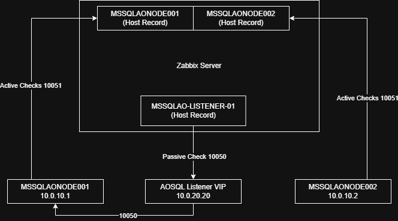
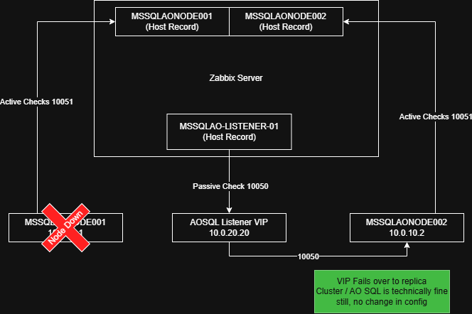

# Preface

As the previous chapter has stated, the Zabbix Agent 2 service is the recommended install 
for your fleet of Windows Operating Systems. Whether it is a fleet of Windows Servers,
Windows Desktops or both, this article will apply. This page will mainly focus around the
configuration file structure of the agent you install on any Windows OS, in addition to
deploying the agent with initial settings you likely will need or want. 

This page assumes you are a Sysadmin of some type and have a means of deploying an
MSI package with PowerShell scripts in steps. Examples of a product that would do this
would be PDQ Deploy or Ivanti Endpoint Manager (formerly Landesk). Though, there is nothing
holding you back if you are a small shop with 20 servers if you are lacking these tools and
need to log in and run some of these steps manually.

It is with the highest intentions that this will prevent unneeded overhead when it comes 
time for agent upgrades, or even auto-registration of new/current servers. **Real world
examples will be provided.**

# Tips For Configuring Your Zabbix Agent 2 fleet

Performing this method of config initially will save you loads of time when upgrading the
agent fleet wide, assuming you are using the Microsoft Installer package (MSI).

This section is a tl;dr but also an index. The page will go in the order of the
list below.

Tips/Index:
- Take your control of your config and look at it as a template
- Keep your `Hostname=` field fully-qualified and lowercase, i.e. `hostname.domain.org`
- Use PowerShell scripting to your advantage to automate the agent config to set the `Hostname=`
- Use `ForceActiveChecks` and `RefreshActiveChecks` for if utilizing ServerActive
- Use `Include=C:\\some\\path\\*.conf` to move customizations out of the default configuration file
- Metadata strings should be defined and should be considered for Autoregistration
- Prioritize using `Active` templates over `Passive` where possible
- Use the MSI installer package for deployment

Examples of the configuration files and PowerShell scripts are provided at the bottom

## Taking control of your config file

The `zabbix_agent2.conf` file should be treated with care. Removing default lines here can 
cause issues when it is time to upgrade. It is ok to add lines at the bottom of the file
but best to use the `Include=` parameter and point it to a new file that you compose in
a different directory.

The whole idea of engineering your Zabbix config file(s) correctly is so future Zabbix Agent
2 upgrades are seamless when running the MSI again in the future.

The `.\zabbix_agent2.d\plugins.d` directory can be used to add more configuration and will
persist through a full agent uninstall. If you have confidential data that needs to be
entered such as `TLSPSKFile` or `TLSPSKIdentity` and you do not wish for this to be 
present in the normal `C:\Program Files\Zabbix Agent 2` directory, you can move this to
be under `%PROGRAMDATA` aka `C:\ProgramData\...` as this directory is hidden by default
on most Windows OS installations from users.

Just note, that when you go to upgrade via MSI (with `NONMSICONFNAME` param), it will 
merge your initial `zabbix_agent2.conf` file with the default; your parameter values will overwrite 
the default values. Be warned, anything custom here may not carry over. Though, Server,ServerActive,Include 
and a few other values will be safe

Each time you change any config file whether it is the main one or included via the
`Include` parameter, you must restart the Zabbix Agent 2 service to apply the changes.

All in all, when it comes for fleet wide management for Windows, take time to read
the base `zabbix_agent2.conf` - if you need anything further than the default
parameters, use `Include=` to define it elsewhere.

Feel free to use the config snippets provided at the bottom this page as a start, 
but I implore you to continue reading the next few sections before you do.

## Using the `Include=` param to your advantage

In the event of the Zabbix Agent 2 upgrade process, via MSI command-line execution, you 
will find that it will do its best to merge the old `C:\Program Files\Zabbix Agent 2\zabbix_agent2.conf`
file into the newly generated zabbix_agent2.conf file.

When this happens, it is important to note even with the `NONMSICONFNAME` MSI param provided
it will not merge/carry-over all the parameters that are set as of 7.0 LTS. In fact, consider the 
`C:\Program Files\Zabbix Agent 2\` root directory a "no-go" zone besides what is needed initially 
for the MSI to perform the install. (Server,ServerActive,Hostname,Include will be saved/carried over)

Params such as `ForceActiveChecksOnStart` and `RefreshActiveChecks` are not brought over. The 
solution to this is to use `C:\Program Files\Zabbix Agent 2\zabbix_agent2.d\plugins.d` 
directory or a custom directory structure built under `%PROGRAMDATA%` to our advantage. 

All in all, put your custom conf files in other directories and utilize `Include=` in the `zabbix_agent2.conf` file
so they persist through a full uninstall of the agent and are not lost during an agent upgrade.

### Custom Solution: Split Custom Configurations To Be Under `%PROGRAMDATA%`

Directory Structure:
```
C:\ProgramData\Zabbix-ext
├── conf.d
│   ├── active_agent.conf
│   ├── custom_config.conf
│   └── metadata.conf
└── scripts
    └── Invoke-ActiveDirectoryChecks.ps1
```

Include one-liner for your `C:\Program Files\Zabbix Agent 2\zabbix_agent2.conf` that will
get all three configs under the `C:\ProgramData\Zabbix-ext\conf.d` directory
```ini
Include=C:\\ProgramData\\Zabbix-ext\\conf.d\\*.conf
```

## Keep Your `Hostname=` parameter value lowercase

This is very important if you are using the `ServerActive` method. Your `Hostname=` value
**must match** the `Host name` field for your host record and it is case sensitive; or your
Active agent templates for Windows will not work.

&#10006; This does not work for Active checks:
- Config File: `Hostname=SOMEserver.domain.com`
- Zabbix Host Record - `Host name` field: `someserver.domain.com`

&#10003; This will work for Active checks:
- Config File: `Hostname=someserver.domain.com`
- Zabbix Host Record - `Host name` field: `someserver.domain.com`

## Use PowerShell Scripting To Your Advantage

Some deployment tools offer a native "MSI Install" step, but lack some customization
on what strings can be passed into the MSI switches. This scenario may not apply
to every reader but it's a good thing to mention.

This can be a problem if you need to set the `Hostname=` a specific way... such as the
targeted endpoint server's hostname.

This section provides a simple example of a "post-install step" in PowerShell you can run to work
around that limitation but still get the result you need/want.

When you plan your initial config for `C:\Program Files\Zabbix Agent 2\zabbix_agent2.conf`
do so in the context of a template so you can use PowerShell later on to replace the
`Hostname=` value with the current FQDN host name during the installation process if
your deployment method does not allow for variables to be inserted into the MSI
switches.

#### Code snippet:
```PowerShell
$file="C:\Program Files\Zabbix Agent 2\zabbix_agent2.conf"
$FQDNHostName = [System.Net.Dns]::GetHostEntry($env:COMPUTERNAME).HostName
$FQDNHostNameToLower = $FQDNHostName.ToLower()
$FQDNHostNameToLower += ".domain.org" # Your domain name but also lowercase if needed
(Get-Content $file) -replace "Hostname=REPLACEME","Hostname=$FQDNHostNameToLower" | Set-Content $file
```

## Utilizing `ForceActiveChecksOnStart` and `RefreshActiveChecks`

These parameters are important for you to understand from a `ServerActive` based
monitoring perspective and are absolutely essential to be in your agent config.

#### ForceActiveChecksOnStart

This param when set to `1` will immediately query the Zabbix server (or Zabbix Proxy)
to check if it has any changes to the configured monitoring templates when the agent
service is started or restarted.

This will also trigger an immediate Low-Level Discovery (LLD) if configured on the
template. It is highly recommended to set this to `1`.

#### RefreshActiveChecks

Similarly to `ForceActiveChecksOnStart`, this parameter is for you to configure
how often the Zabbix Agent2 checks in with a Zabbix Server (or Zabbix Proxy) for
new/updated Active Monitoring templates. This param value is defined in `seconds`
for time. A good value to start would be `RefreshActiveChecks=300`, which would
be 5 minutes.

If you make a change to a monitoring template or host specific macro override,
this will ensure it is picked up. However, if it is a change that requires
Low-Level Discovery (LLD) to run, you must wait for that LLD's threshold
to trigger.

## Metadata and Autoregistration

If you are considering using Metadata strings, these should also be split out (via `Include=`)
especially if you are allowing agent auto-registration.

Metadata can help you control and direct auto-registration actions to apply different templates
based on whatever you put in `HostMetadata`

Some organizations will just use a single string and call it a day. Other organizations may
choose to set their metadata string based on server role. If you are splitting by role,
obviously this will be set per server install or changed after the install.

Please note, if the `HostMetadata` value is ever changed, upon the agent restarting, the
Zabbix Server will kick off an auto-registration action if one is defined for it. If the
`HostMetadata` value never changes for the agent/endpoint's lifetime, auto-registration
will never execute again after executing for the first time.

Of course, you still must configure auto-registration actions via the Zabbix Server.

Example 1:
```ini
HostMetadata=WindowsServer
```

Example 2:
```ini
HostMetadata=WindowsServer_DomainController
```

Example 3:
```ini
HostMetadata=WindowsServer_MSSQLServer
```

## Active vs Passive Monitoring Templates

If you have made it this far, you are probably under the impression that
the author(s) of this page are heavily leaning towards Active based checks.

There are scenarios for both and thankfully both can be used at the same time.

From a design/architectural standard, Active checks should always be used. However,
In some cases, you may not be able to send data from a DMZ subnet back to internal,
but the company policy states connections that originate from internal the internal WAN/LAN
enterprise network may communicate out to the DMZ.

By default, in your agent config you should be prepared for both scenarios by
setting `Server=` (Passive) and `ServerActive=` (Active) by default.

### When to use Active Templates

Anything that requires LLD for discovering disks (C:\\...D:\\ etc...) or Windows
Services, CPU, RAM... all your basic monitoring needs should be placed onto the
agent to collect to take the load off of your Zabbix Server/Proxy.

Active Checks are heavily preferred especially in Windows environments where
querying `perfmon` can be slow during high CPU loads or disk I/O contention.

### When to use Passive Templates

This can be tricky but a specific scenario came up where one organization needed
to monitor the status of a Microsoft SQL Always-On Availability group. The problem
with this is, that consists of multiple hosts that already exist in Zabbix and are
sending information. A cluster can be healthy overall, but a specific node can
be not healthy and potentially be down. So if you are monitoring the cluster from
only a single node and not all of them... you could miss an alert. On the other end,
if you apply a template to all three hosts you have duplicate data.

The question becomes: How do you monitor the cluster health as a single entity?

**The solution:**
The organization created a separate Passive Template to query the Microsoft SQL
Always-On Listeners specifically (which is a Virtual IP that migrates between 
the hosts). They then created new hosts in Zabbix for each listener and used
a Passive check against the Always-On Listener IP. If the Availability group
failed over to a new node, the Zabbix Server/Proxy still is querying the same
IP, even though it's now gathering information about the cluster from a different
server/zabbix agent.



_Normal Operations_



_Microsoft Always On Listener Failover_

## Using the MSI Installer is Preferred

This goes without saying too much so we won't spend too much time here.

When it comes to deployment of the Zabbix Agent 2, you need an installation package
that can perform the installation & upgrade with a few requirements in mind for Windows:
- Standardized Silent Installations
- Standard Switches for install options
- Standard switch for repair/installing more agent plugins
- Easier Management via PDQ Deploy/Ivanti Endpoint Manager/SCCM/Group Policy/Intune

MSI meets those requirements easily especially with detecting whether it's installed already.

### Example Install Command (General):
```
msiexec.exe /i "C:\temp\zabbix_agent2-7.0.30-windows-amd64-openssl.msi" HOSTNAME="someendpoint.domain.com" SERVER="zabbixnode1ipaddress,zabbixnode2ipaddress" SERVERACTIVE="zabbixnode1ipaddress;zabbixnode2ipaddress" /qn /silent
```

### Example Upgrade Command (You'd use this for upgrades if following the configs posted at the end of the page):
```
msiexec.exe /i "zabbix_agent2-7.0.31-windows-amd64-openssl.msi" NONMSICONFNAME="C:\Program Files\Zabbix Agent 2\zabbix_agent2.conf" /qn /silent
```

### Order for MSI/Script Install

If you are going full MSI + PowerShell 5.1 (Windows PowerShell) for installing the agent, creating the "Zabbix-ext" directory and applying a templated zabbix_agent2.conf go in the following order:

1. Install the Agent via MSI normally
    - Optional Edge Case: Have a PowerShell script overwrite `C:\Program Files\Zabbix Agent 2\zabbix_agent2.conf` with the `Hostname=`,`Server=`,`ServerActive=` fields with your required values if you are unable to set them via the MSI switches for any reason. A small example on how to do this inline without overwriting the entire file was provided [earlier on this same page - click here to jump](windows-zabbix-agent2-config-tips.md##code--snippet)
        #### Why?

        Some products like Ivanti Endpoint Manager/SCCM/PDQ Deploy have a native MSI install steps for deployment 
        tasks so you don't need to write a PowerShell or Batch script to perform the install. The deployment tool
        will call it natively in `cmd.exe` with the `msiexec /i....` command
        #### Great. What's the catch? 
    
        In the case of some deployment tools - the "MSI native" method doesn't exactly make it easy to insert 
        the params of the current machine you are targeting in a deployment for the command switches 
        themselves as variables without causing a 'hacky way' to go about it.
        
        As an example, a specific deployment tool does not allow this: `/HOSTNAME="{{DEPLOYMENT_TOOL_VAR_TARGET_SERVER_NAME}}"`
        and must be inline string literals only - the deployment tool does not allow a variable to be passed via the deployment 
        package for the MSI Method switches. 
        
        Or, In other hyper specific cases, the tool lacks adding a string or general string manipulation like this in line for 
        the MSI switch: `/HOSTNAME="{{DEPLOYMENT_TOOL_VAR_TARGET_SERVER_NAME}}"+'.domain.com'`
        
        In this case, the org needs to put an additional step in PowerShell to edit the `zabbix_agent2.conf` in-place
        after the the initial MSI install to correct it to their liking.
2. Have a PowerShell Script create the "Zabbix-ext" directory under `%PROGRAMDATA%` with the `.conf` files
3. Have a PowerShell Script insert `Include=` fields at the bottom the `C:\Program Files\Zabbix Agent 2\zabbix_agent2.conf` file or create a new file as such `C:\Program Files\Zabbix Agent 2\zabbix_agent.d\plugins.d\custom_includes.conf`
4. Have a PowerShell Script restart the agent to apply all changes
5. Have a PowerShell Script command Windows to attempt to restart the Zabbix Agent 2 service if it fails via `sc.exe`

    ```
    # PowerShell One Liner Set service to restart itself if it fails to start.
    & "$env:SystemRoot\System32\sc.exe" failure "Zabbix Agent 2" actions= "restart/60000/restart/60000/restart/60000" reset= 86400
    ```

## Real-World Example Configs - Single Highly-Available Zabbix Environment

This includes the standard configuration in the default location in addition to adding the "Zabbix Extended" directory under `%PROGRAMDATA%` instead of the `zabbix_agent2.d`

You can use a PowerShell command to overwrite `Hostname=` matching on `Hostname=REPLACEMEBUTLOWERCASE.domain.com`

### C:\Program Files\Zabbix Agent 2\zabbix_agent2.conf
```ini
# C:\Program Files\Zabbix Agent 2\zabbix_agent2.conf (Snippet with author comments)
# This is a snippet of the main conf file with author comments
# Remember to not remove the default params/lines from here, but you can change the Server and ServerActive values and add Include= at the bottom.
# Just don't customize this base file any further than those param values.

# Log File Config
# This is set by default by the agent at install/upgrade in the base file
LogFile=C:\Program Files\Zabbix Agent 2\zabbix_agent2.log

#...file continues...

# Server Passive Config (Zabbix server/proxy polls this endpoint)
# This is set by the user via MSI installer at the time of install
Server=10.0.1.24,10.0.1.25

#...file continues...

# Server Active Config (Endpoint sends telemetry to Zabbix server/proxy)
# Note server active HA nodes of the same env are split via semi-colons ; 
# --- this pre-formatted text makes it look like an ini file comment.
# This is set by the user via MSI installer at the time of install
ServerActive=10.0.1.24;10.0.1.25

#...file continues...

# Preferably, you should fully qualify your hostname and make it lowercase
# For ServerActive configurations, this field is REQUIRED and is case sensitive!
# This is set by the user via MSI installer at the time of install
Hostname=REPLACEMEBUTLOWERCASE.domain.com

#...file continues...

# Include configuration files for plugins.. you can also do a literal path here if needed
# Include=C:\\Program Files\\Zabbix Agent 2\\zabbix_agent2.d\\
# This is set by default by the agent at install/upgrade in the base file
Include=.\zabbix_agent2.d\plugins.d\*.conf

#...file continues...

# Include any extra config directories at the bottom of your config file
# This is a custom one that was added by the System Administrator in order
# to place the custom configs in the %PROGRAMDATA% directory so it is hidden
# from Non-Administrators.
Include=C:\\ProgramData\\Zabbix-ext\\conf.d\\*.conf
```

### The "Zabbix-ext" Directory / Config Files / Custom Scripts

Directory Structure of Zabbix-ext under `%PROGRAMDATA%`:
```
C:\ProgramData\Zabbix-ext
├── conf.d
│   ├── active_agent.conf
│   ├── custom_checks.conf
│   ├── metadata.conf
│   ├── key.psk
│   └── psk_options.conf
└── scripts
    └── Invoke-ActiveDirectoryChecks.ps1
```

#### C:\ProgramData\Zabbix-ext\conf.d\active_agent.conf
```ini
# To be used with the deployment package, this file is intended to be changed
# per server or fleet wide if all agents must have it changed.
# I.E. WindowsServer_ActiveDirectoryServers ---> Autoregistration Action puts it into Host group
# This file shall be placed as such C:\ProgramData\Zabbix-ext\conf.d\active_agent.conf

# Forces the agent to get its config on start immediately
ForceActiveChecksOnStart=1

# How often list of active checks is refreshed, in seconds.
RefreshActiveChecks=300
```

#### C:\ProgramData\Zabbix-ext\conf.d\custom_checks.conf
```ini
# You can put custom UserParameters here or split them out per .conf file
UserParameter=PowerShell.ps_dcdiag_checks,PowerShell -ExecutionPolicy Bypass -File "C:\ProgramData\Zabbix-ext\scripts\Invoke-ActiveDirectoryChecks.ps1"
```

#### C:\ProgramData\Zabbix-ext\conf.d\metadata.conf
```ini
# This file shall be placed as such C:\ProgramData\Zabbix-ext\conf.d\metadata.conf
HostMetadata=WindowsServer
```

#### C:\ProgramData\Zabbix-ext\conf.d\key.psk

_Don't worry this is not a real key used anywhere, purely as an example of what is in the file_

```txt
c63e00000c9999999926fd58e24cdhotdogs7f54burgers627932efries87e79
```

#### C:\ProgramData\Zabbix-ext\conf.d\psk_options.conf
```ini
# PSK Config
# openssl rand -hex 32, store it into key.psk
TLSConnect=psk
TLSAccept=psk
TLSPSKFile=C:\\ProgramData\\Zabbix-ext\\conf.d\\key.psk
TLSPSKIdentity=PSK-001
```

#### C:\ProgramData\Zabbix-ext\scripts\Invoke-ActiveDirectoryChecks.ps1
```PowerShell
# This script is meant to be ran on a Windows Domain controller to perform some basic health checks
# It will return a JSON payload that can be later used in a template
# Add more tests here if you need
$tests = "services","replications","advertising","fsmocheck","ridmanager","machineaccount","connectivity","FRSSysvol"

# Runs dcdiag /test:INPUTSTRINGHERE - Looks for "passed test", returns PSCustomObject as @{INPUTSTRINGHERE: INTEGER}
function Invoke-DcDiagTest {
    param (
        [Parameter(Mandatory=$true)][string]$TestName
    )

    $ReturnPSCustomObject = [PSCustomObject]@{}

    $result = dcdiag /test:$TestName | Select-String "failed"
    If ($result) {
        $ReturnPSCustomObject | Add-Member -MemberType NoteProperty -Name $TestName -Value 0 # means bad!
    } else {
        $ReturnPSCustomObject | Add-Member -MemberType NoteProperty -Name $TestName -Value 1 # 1 means good!
    }

    return $ReturnPSCustomObject
}

$GlobalAllTestsOK = 1 # Preset true unless test fails
$OutputOfTests = [PSCustomObject]@{} # Return PSCustomObject we will convert to a JSON

ForEach ($TestToRun in $tests) {
    $SingularTest = Invoke-DcDiagTest -TestName $TestToRun
    $OutputOfTests | Add-Member -MemberType NoteProperty -Name $TestToRun -Value $SingularTest.$TestToRun
    If ($SingularTest.$TestToRun -eq 0) {
        $GlobalAllTestsOK = 0 # If any of the tests fail set GlobalAllTestsOK flag to 0 (false)
    }
}


$OutputOfTests | Add-Member -MemberType NoteProperty -Name "AllTestsPassed" -Value $GlobalAllTestsOK

# TEST OVERRIDE FOR TESTING
# $OutputOfTests.services = 0 # DEBUG
# $OutputOfTests.AllTestsPassed = 0 # DEBUG 

# Convert to JSON so Zabbix template can read it
$JSONOutput = $OutputOfTests | ConvertTo-JSON 

return $JSONOutput
```